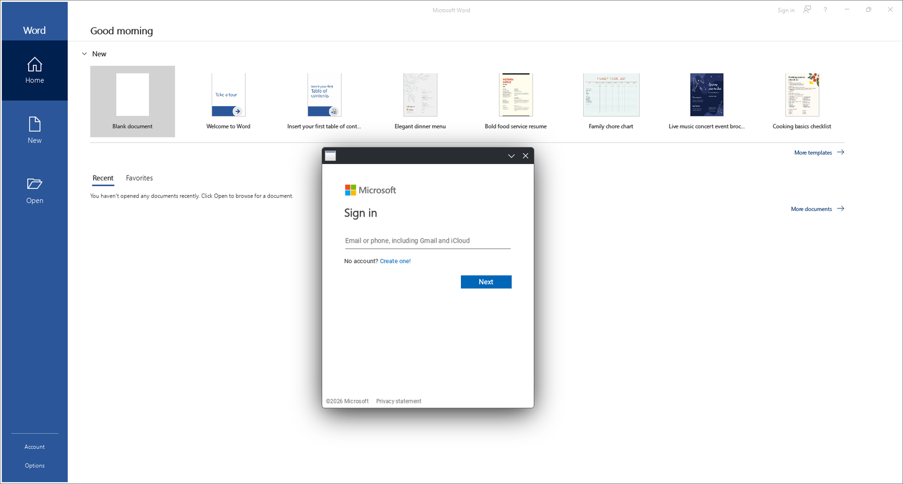

# Microsoft 365 under Wine

Scripts that install Microsoft 365 (Click-to-Run Office: Word, Excel,
PowerPoint) into a fresh Wine prefix and run it, with the workarounds Office's
installer, licensing, rendering and sign-in need under Wine. Office runs on
**GE-Proton11-7**'s Wine (downloaded into the prefix), not on the system Wine.

Tested on Arch Linux (KDE Plasma 6 Wayland session, Wine through Xwayland,
AMD GPU with RADV) with the `OfficeSetup.exe` installer from office.com for a
Microsoft 365 Education account (product `O365EduCloudRetail`, Office
16.0.20326). A fresh `install.sh` run takes about 25 minutes on a fast
connection; Word, Excel and PowerPoint then start, render and show Microsoft's
sign-in page. On the install these scripts were made from, signing in
activated Office and Word, Excel and PowerPoint open and edit documents.
Also in use on a second Arch machine (KDE Plasma 6 Wayland, AMD integrated GPU
driving the display plus an NVIDIA GPU, Arch's WoW64 `wine` installed,
`O365ProPlusRetail`): Word signs in, activates and edits documents there.

Most of the Wine workarounds come from
[Tombert/office365_flake](https://github.com/Tombert/office365_flake) (a Nix
setup of Microsoft 365 on Proton); this repository packages them as plain
scripts for any distribution, plus what this setup needed on top (the WebView2
sign-in fixes, VC++ runtime, menu entries).

Licensing is left to Microsoft: Office asks you to sign in with the account
that has your Microsoft 365 subscription on first start.

## Install

Needs `curl`, `tar`, `cabextract`, `python3`, `winetricks`, a 32-bit FreeType
library, a working Vulkan driver (Office draws through DXVK), a graphical
session, internet access, about 15 GB of disk and 25–90 minutes, mostly
Office's own download.

The 32-bit FreeType library is easy to miss: distribution Wine packages built
as pure WoW64 (Arch's `wine` since 11) no longer pull it in, but GE-Proton's
Wine still runs some 32-bit programs, and without it the prefix gets corrupt
window metrics (every Office window invisible). `install.sh` stops when it is
missing. Arch: `pacman -S lib32-freetype2` (`[multilib]`); Debian/Ubuntu:
`dpkg --add-architecture i386 && apt install libfreetype6:i386`; Fedora:
`dnf install freetype.i686`.

1. Download Office's installer from your account: sign in at
   <https://www.office.com>, *Install apps* → *Microsoft 365 apps*. You get
   `OfficeSetup.exe`.
2. Run:

       git clone https://github.com/ExonSounds/Office-365-Wine
       cd Office-365-Wine
       ./install.sh ~/Downloads/OfficeSetup.exe

| Option | |
|---|---|
| `--prefix DIR` | prefix to create or use (default `~/.office_365`); no spaces or quotes in the path |
| `--no-desktop` | skip the Word/Excel/PowerPoint menu entries and "Open with" associations |
| `--powershell` | also install PowerShell 7 into the prefix |
| `--reinstall` | run Office's installer again even though Office is installed |
| `--clean-cache` | delete the downloaded GE-Proton and WebView2 archives (~950 MB) afterwards |

Office's installer window opens during step 5; leave it alone, `install.sh`
closes it when Click-to-Run has finished. `install.sh` is safe to re-run: done
steps are skipped, so re-running also repairs an install. Its log goes to
`PREFIX/install-logs/`; Click-to-Run's own logs to
`PREFIX/drive_c/users/*/AppData/Local/Temp/` and `PREFIX/drive_c/windows/temp/`.

What it does:

1. Downloads GE-Proton11-7 (checksum-verified, cached in
   `~/.cache/office-365-wine`) into `PREFIX/runner`.
2. Copies this folder to `PREFIX/wine-office-fixes`, creates a 64-bit prefix
   with GE-Proton's Wine (without Wine Gecko and without winemenubuilder, so
   Wine adds no Linux menu entries for Windows programs), then
   `winetricks win10 corefonts msxml6 msxml3 vcrun2022`.
3. Applies the Wine workarounds below (`apply-fixes.sh`).
4. Unpacks the Microsoft Edge WebView2 runtime, Fixed Version 152.0.4191.62
   (checksum-verified), into `C:\Program Files\WebView2Fixed`; Office's
   sign-in page is a WebView2 window.
5. Runs `OfficeSetup.exe` and follows Click-to-Run's logs (`c2rlog.py`;
   progress every minute) until it reports the installation complete. An
   attempt in which a Click-to-Run task fails, that can't reach Microsoft's
   servers for 5 minutes or makes no progress for 30 is stopped and retried
   (up to 3 attempts; Click-to-Run resumes its download).
6. Runs `apply-fixes.sh` again for the steps that need Office's files, and
   (unless `--no-desktop`) adds `~/.local/share/applications/ms365-*.desktop`.

## Run

    PREFIX/wine-office-fixes/office word|excel|powerpoint [file]

or Word / Excel / PowerPoint in the application menu (also offered under
"Open with" for Office documents). OneNote, Outlook, Access and Publisher are
accepted by the launcher when your product includes them, but untested.

On first start Office shows "Sign in to get started": sign in with your
Microsoft account; Office then activates from it (the licence is kept in the
prefix).

Always start Office through the launcher, and never run the system `wine` on
this prefix (it would start a second, mismatched wineserver). For `wine`,
`winetricks` or `regedit` on the prefix, load its environment first:

    . PREFIX/wine-office-fixes/env.sh
    winetricks ...

After an Office update, or when something stops working, run
`PREFIX/wine-office-fixes/apply-fixes.sh` (Office closed).

GE-Proton runs programs as Windows user `steamuser`: Office's settings are
under `PREFIX/drive_c/users/steamuser`. Linux files are on drive `Z:`.

### Settings for this machine

`env.sh` also loads `PREFIX/local-env.sh` if it exists; `install.sh` never
touches that file. Use it for settings that only fit one machine, for instance
the GPU Office renders on. With several GPUs DXVK takes the first one Vulkan
reports, often a discrete card while the desktop runs on another; that works,
but keeps the card busy (a VFIO passthrough VM can't take it while Office
runs). To render on the GPU driving the display, let Vulkan see only its
driver (here AMD's RADV):

    # PREFIX/local-env.sh
    export VK_DRIVER_FILES=/usr/share/vulkan/icd.d/radeon_icd.json
    export VK_ICD_FILENAMES="$VK_DRIVER_FILES"   # older Vulkan loaders

## Wine workarounds

| File | Problem it works around |
|---|---|
| `shim/sppc.dll` (office365_flake) | Wine's Software Protection Platform client is stubs; Office's integrator aborts in `SLInstallLicense` (Click-to-Run error 0-2031 / 17002). The shim accepts licences and reports none. |
| `shim/ole32.dll` (office365_flake `shim.c`) | Forwards all of Wine's ole32 (kept as `ole32_wine.dll`) and adds `CoRegisterActivationFilter`, which Office dereferences as NULL; from its DllMain it patches other gaps Office hits: Direct2D SVG documents, kernel32 functions Wine lacks, `QueueUserAPC2`, Windows.Web.Http classes. Also loaded into every process as `ms365shim.dll` through `AppInit_DLLs` (Excel never loads ole32 itself). |
| `shim/ms365uia.dll` (office365_flake `uia.c`) | `CLSID_CUIAutomationRegistrar` (Excel crashes as soon as a workbook has focus) and `CLSID_InkDisp` (OneNote). Wine re-registers its own class whenever the prefix is updated; the `office` launcher checks for that and restores ours. |
| `d2d1-wine11.16.dll` | GE-Proton 11's Direct2D ignores geometry-group fill modes, so ribbon controls become solid blocks; Wine 11.16's `d2d1.dll` is used instead. |
| GE-Proton's DXVK and vkd3d (`apply-fixes.sh`) | Office composes its UI from Direct3D 11 textures shared across threads (keyed mutexes); upstream Wine's wined3d leaves the window blank. GE-Proton's Wine with its own DXVK supports them. |
| `fonts/selawk*.ttf`, Tahoma (`office-wine.reg`) | Office's UI font is Segoe UI, which Wine lacks: mapped to Selawik, Microsoft's metric-compatible open stand-in. Selawik and Wine's Tahoma are copied to `C:\windows\Fonts` and registered, so DirectWrite finds them: without Tahoma there, WebView2 recurses forever looking up the system message font and the sign-in window stays blank. |
| WebView2 Fixed Version 152 + `msedgewebview2.exe` in Windows 7 mode | Office's sign-in page. In Windows 7 mode Chromium doesn't use DirectComposition, which Wine only stubs (its GPU process would crash-loop). |
| Identity settings (`office-wine.reg`) | Wine has no Web Account Manager: Office uses the WebView2-based sign-in flow instead (ADAL/OneAuth switches and feature gates). |
| Token licensing (`apply-fixes.sh`) | `LicensingNext\<product>=2` for each installed product: Office licenses itself from the signed-in account instead of the Software Protection Platform checks Wine can't satisfy. |
| VC++ runtime (`apply-fixes.sh`) | Office crashes with Wine's builtin `vcruntime140`/`msvcp140` (`__C_specific_handler_noexcept`). Office's own redist installer leaves Wine's copies in place (they report a newer version); the DLLs are then extracted from Microsoft's redist packages. |
| `riched20`, `appxdeploymentclient`, `hvsimanagementapi` (`office-wine.reg`) | Office's own RichEdit instead of Wine's; Wine's PackageManager and Windows Sandbox stubs disabled for Office (Click-to-Run turns them into fatal errors) but kept for the installer, which needs PackageManager to exist. |
| `root/vfs` symlinks (`apply-fixes.sh`) | Office keeps most DLLs under `root/vfs/<KnownFolder>` and relies on App-V to redirect the real paths there, which is unreliable under Wine; the tree is mirrored into the real folders. |
| `msi-components.py` (office365_flake) | The integrator's MSI registrations (proofing tools, VBA, add-ins) stay empty under Wine; rebuilt from Click-to-Run's manifests. FM20.DLL is registered for VBA UserForms. |
| `office` launcher | Re-applies the fixes when a Wine prefix update has put Wine's own `ole32.dll` back over the shim (for instance after the system Wine ran on the prefix: Word would crash at start). Restores `ClickToRunPackageLocker`'s permissions (Office sets an ACL that Wine maps to mode 000, and the next start fails with "access denied"), skips Office's "start in safe mode?" prompt after a crash, starts Word with `/q` (its splash screen hangs), converts Linux paths of documents. |
| `Xresources` (`XENVIRONMENT` in `env.sh`) | With the desktop's subpixel font antialiasing (`Xft.rgba: rgb`, KDE Plasma's default) Wine renders text in LCD mode, and GE-Proton 11's `freetype_get_glyph_outline` dereferences a NULL bitmap for the very wide glyphs of Office's font-preview font; Wine catches the fault but leaves its font lock held, and Word freezes as soon as the ribbon's font list is scrolled. Wine gets grayscale antialiasing instead; the rest of the desktop keeps its setting. |
| Window metrics (`apply-fixes.sh`) | A prefix created without a 32-bit FreeType has title-bar and menu heights in the millions of pixels (`HKCU\Control Panel\Desktop\WindowMetrics`): every window is invisible or a blank white box. Such values are deleted, and Wine writes its defaults again. |
| `bin/winepath`, `wine wineboot` | GE-Proton ships no `winepath` or `wineboot` commands; a bare `winepath`/`wineboot` would start the system Wine on the prefix (winetricks calls `winepath`). The scripts run GE-Proton's `wineboot.exe` through `wine`. |

## PowerShell (optional)

`install.sh --powershell` installs PowerShell 7 (`winetricks powershell`) into
the prefix; it sees the prefix's registry and files, the same view Office has.
Run it from a terminal:

    PREFIX/wine-office-fixes/powershell
    PREFIX/wine-office-fixes/powershell -File 'Z:\home\you\script.ps1'

PSReadLine is moved aside (`Modules/PSReadLine.disabled-under-wine`) because
its signature check crashes in Wine, so the prompt has basic line editing. .NET
runs in globalization-invariant mode (Wine's ICU lacks symbols it needs). With
its output piped into another program PowerShell's console host exits without
running anything; run it in a real terminal.

## Known state / open issues

- Word, Excel and PowerPoint work, signed in and activated; tested with an
  Education subscription. Other subscription types use the same installer and
  licensing path, but are untested.
- Not tested: OneNote, Outlook, Access, Publisher, macros beyond VBA forms,
  OneDrive saving, printing.
- Documents use Calibri/Cambria; until Office downloads its cloud fonts they
  are mapped to Carlito and Caladea if installed (Arch:
  `pacman -S ttf-carlito ttf-caladea`).
- "Wine cannot find the FreeType font library" means the 32-bit FreeType
  library is missing; it is not harmless (see Install). Install it, then run
  `apply-fixes.sh` (or `install.sh` again) to repair the prefix.
- Office's automatic updates may undo workarounds; run `apply-fixes.sh` after
  an update.

## Uninstall

    PREFIX/wine-office-fixes/install-menu-entries.sh --remove
    rm -rf PREFIX ~/.cache/office-365-wine

## Licences

The scripts are GPL-3.0 (`LICENSE`). `shim/` and `msi-components.py` are from
office365_flake, LGPL-2.1 (`shim/LICENSE`); `shim/BUILD.txt` and
`shim/build.sh` rebuild the DLLs. `d2d1-wine11.16.dll` is Wine's Direct2D from
Wine 11.16 (Arch Linux package `wine-staging-11.16-2`), LGPL-2.1; source at
<https://dl.winehq.org/wine/source/11.x/wine-11.16.tar.xz>. The Selawik fonts
are Microsoft's, SIL Open Font License 1.1 (`fonts/LICENSE.txt`).
GE-Proton, Microsoft 365 and the WebView2 runtime are downloaded from their
publishers and are under their own licences: the WebView2 Fixed Version
runtime under Microsoft's WebView2 Runtime licence, Office under your Microsoft
365 subscription terms.
